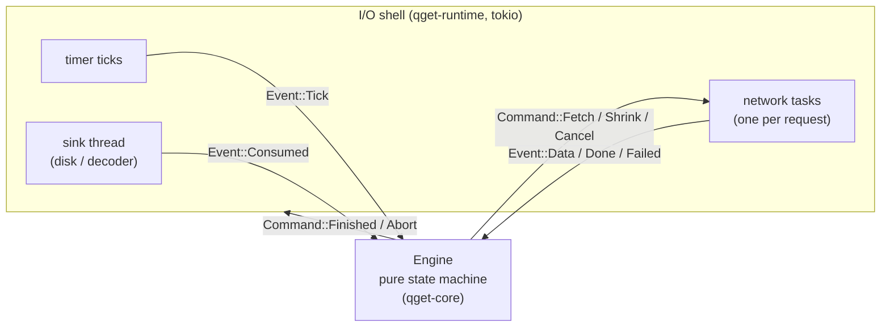
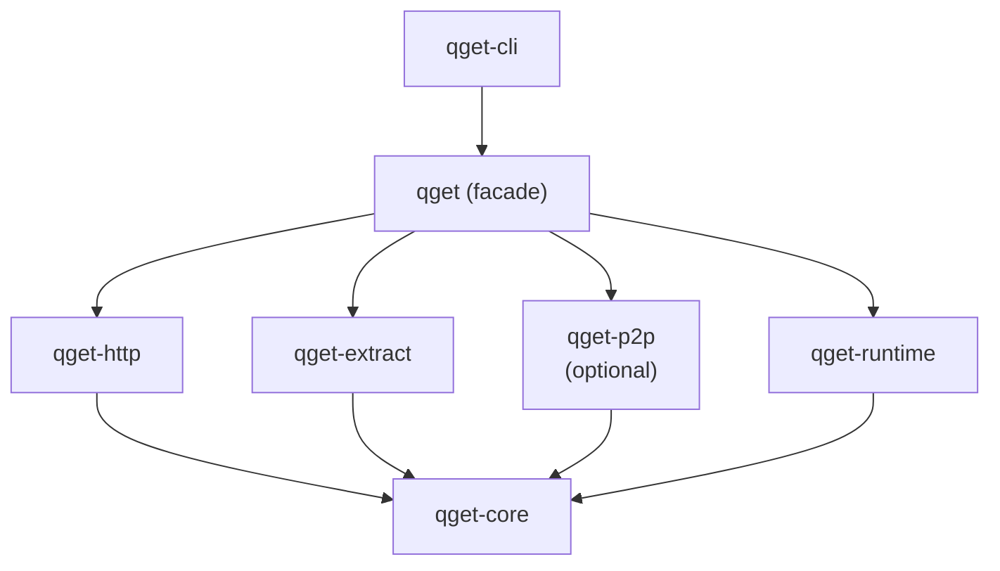

<!-- covers: crates/qget-core/src/source.rs crates/qget-core/src/sink.rs crates/qget-core/src/error.rs crates/qget/src/lib.rs crates/qget-runtime/src/lib.rs crates/qget-p2p/src/lib.rs scripts/check-deps.sh -->

# 1. Architecture

qget is one binary built from a Cargo workspace of library crates. Nothing runs
as a separate process or service. This document explains how the crates are
split, what each is allowed to depend on, and the single idea the rest of the
design rests on.

## The core idea: a pure engine inside an I/O shell

Every decision qget makes (which bytes to request next, from which source, how
many connections to run, when to retry, when to duplicate a slow request) is
made by one function:

```rust
impl Engine {
    pub fn handle(&mut self, ev: Event) -> Vec<Command>
}
```

The engine never reads the clock, never opens a socket, never touches a file
and never uses ambient randomness. Time arrives *inside* events as a
millisecond timestamp. Randomness comes from a seeded generator stored in the
engine. Everything else (HTTP, QUIC, disk, timers) lives outside it, in the
runtime.



This pattern is often called *sans-I/O* (the same design as `quinn-proto`).
It buys three things that are otherwise very hard to get:

1. **Determinism.** The same sequence of events always produces the same
   commands. A recorded run can be replayed exactly (`--trace`, `qget replay`).
2. **Simulation testing.** A test can feed the engine synthetic events from a
   fake network with stragglers, resets and throttling, run thousands of
   seeds in seconds, and check invariants after every step. See
   [Determinism and testing](09-determinism-and-testing.md).
3. **One scheduler for every transport.** HTTP mirrors and P2P peers are both
   just "sources" to the engine, so hybrid downloads need no special cases.

## The crates

```
crates/
├── qget-core        pure logic, no I/O: engine, journal encoding, range sets,
│                    hashing, BLAKE3 groups, Content-Range parser, simulator
├── qget-runtime     tokio event loop, crash-safe file sink, stream sink,
│                    rate limiter, decision traces
├── qget-http        HTTP(S) source: probing, range requests, validation
├── qget-extract     streaming tar / lz4 / zstd / gzip / xz extraction
├── qget-p2p         peer-to-peer over iroh (feature `p2p`)
├── qget             public library facade: the Download builder
├── qget-cli         the `qget` binary: flags, progress, exit codes
└── qget-testserver  fault-injecting HTTP server used by tests and benchmarks
```

Dependency direction (arrows mean "depends on"):



### The rules, and how they are enforced

| Rule | Why | Enforced by |
|---|---|---|
| `qget-core` performs no I/O (LIB-02) | Determinism and simulation depend on it | `scripts/check-deps.sh` compares `cargo tree -p qget-core` against an allow-list of pure-computation crates (hashing, serde, `bytes`, `thiserror`) |
| The default build does not depend on iroh (LIB-08) | Debian and Fedora package every Rust dependency separately; iroh's large tree would block distro inclusion of the default build | `scripts/check-deps.sh` fails if `cargo tree -p qget-cli` contains `iroh` |
| Source and sink crates depend only on `qget-core`, never on each other | Keeps every transport interchangeable | The compiler: undeclared dependencies don't build |
| The CLI uses only the public `qget` API (LIB-03) | Proves the library is sufficient for real use | Code review; `qget-cli` only declares `qget` |
| Library crates never print, never call `process::exit`, keep no global mutable state (LIB-04) | Embedders must stay in control | Code review; diagnostics go through `tracing` |

Both scripted checks run in CI on every push (`.github/workflows/ci.yml`, job
`lint`).

## The two interfaces that connect everything

### `Source`: anything that can serve a byte range

```rust
pub trait Source: Send + Sync + 'static {
    fn open(&self, range: ByteRange) -> BoxFuture<'static, Result<Box<dyn ChunkStream>, FailKind>>;
    fn describe(&self) -> String;
}

pub trait ChunkStream: Send {
    fn next_chunk(&mut self) -> BoxFuture<'_, Option<Result<Bytes, FailKind>>>;
}
```

`open` starts a request for `[start, end)` and returns a stream of body chunks
in order. Errors are already *classified* into a `FailKind` (transient,
throttled, or fatal), because that classification is what the engine needs to
decide what to do next. The trait uses only `std` types so `qget-core` stays
runtime-free.

Implementations:

| Implementation | Crate | Serves bytes from |
|---|---|---|
| `HttpSource` | `qget-http` | An HTTP(S) URL using `Range` + `If-Range` |
| `PeerSource` | `qget-p2p` | A peer over a QUIC stream, verifying each 1 MiB group |
| `VerifiedSource` | `qget-p2p` | Wraps any other source (e.g. an HTTP mirror) and verifies each 1 MiB group against a BLAKE3 tree |

### `Sink`: where bytes go

```rust
pub trait Sink: Send {
    fn write(&mut self, offset: u64, data: Bytes) -> Result<()>;
    fn consumed(&self) -> Option<u64> { None }
    fn finish(&mut self) -> Result<SinkReport>;
    fn abort(&mut self) -> Result<()>;
}
```

Writes may arrive in any order and may overlap; overlapping writes always
carry identical bytes because sources are validated first. The runtime calls
the sink from a dedicated thread, so `write` is allowed to block, and blocking
is how backpressure reaches the network.

| Implementation | Used for | Durable? |
|---|---|---|
| `FileSink` | Normal downloads, `--keep-archive`, P2P receive | Yes: journal + fsync ordering, resumable |
| `StreamSink` | `-O -` (stdout) and `--extract` without `--keep-archive` | No: bytes are reordered in memory and handed to an `OrderedConsumer` |

An `OrderedConsumer` receives the download as one in-order byte stream. The
extractor and stdout writer are both consumers.

## Errors and exit codes

All crates share one error type, `qget_core::Error`, marked `#[non_exhaustive]`.
Each variant maps to exactly one documented exit code (LIB-07, CLI-03):

| Code | Variant | Meaning |
|---|---|---|
| 0 | | Success |
| 1 | | Unexpected internal error |
| 2 | `Usage` | Invalid usage (also: another qget is already writing this file) |
| 3 | `Network` | Connection, DNS, TLS, timeout, or retries exhausted |
| 4 | `HttpStatus` | An HTTP error status such as 404 or 403 |
| 5 | `Integrity` | Checksum or BLAKE3 verification failed |
| 6 | `RemoteChanged` | The remote file changed during or between runs |
| 7 | `Io`, `DiskFull` | Local I/O error or disk full |
| 8 | `Interrupted` | Interrupted; re-run the same command to resume |
| 9 | `Extract` | Archive extraction failed |
| 10 | `P2p` | Peer-to-peer transfer failed |
| 11 | `Unsupported` | Unsupported server, input or build feature |

Inside the engine, failures are first classified as `FailKind` (see
[The scheduler](04-scheduler.md#failure-handling)). Only when the engine gives up
does the runtime convert its `FatalKind` into one of these errors.

## Cargo features

| Feature | Default | Adds |
|---|---|---|
| `extract` (facade) | yes | `qget-extract`: `--extract` and directory P2P shares |
| `p2p` (CLI, facade) | no | `qget-p2p` and iroh: `yeet`, `yoink`, `mailbox`, hybrid downloads |
| `http3` (`qget-http`) | no | Experimental HTTP/3; also needs `RUSTFLAGS=--cfg reqwest_unstable` |

Release binaries are built with `p2p` enabled; distro packages can ship the
lean default build.

Next: [The life of a download](02-download-lifecycle.md).
