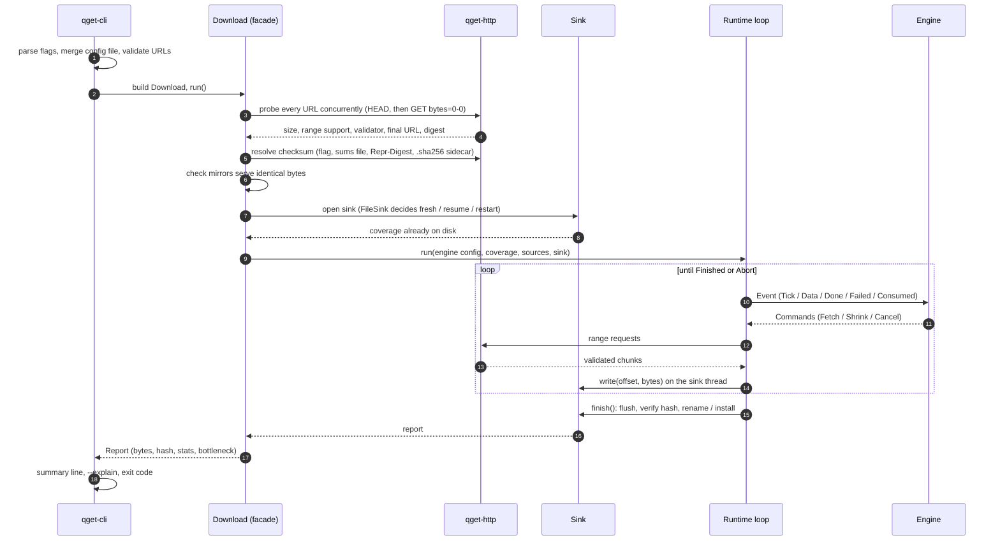
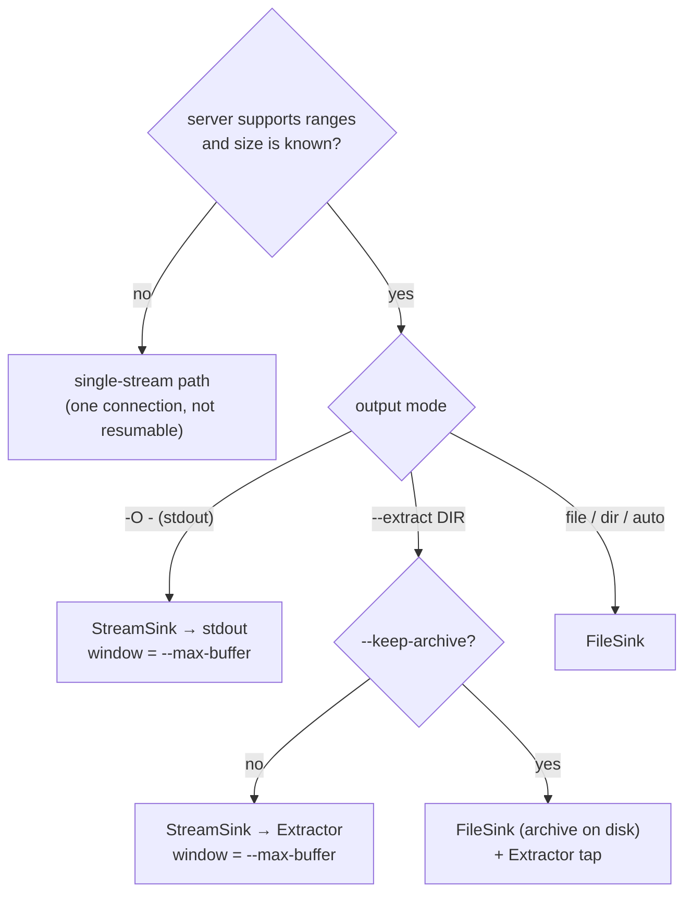

<!-- covers: crates/qget/src/download.rs crates/qget/src/refresh.rs crates/qget-cli/src/main.rs crates/qget-cli/src/cli.rs crates/qget-cli/src/config.rs crates/qget-core/src/hash.rs -->

# 2. The life of a download

This document follows one command from start to finish, in the order things
actually happen:

```sh
qget https://snapshots.example.com/chain.tar.lz4 --extract /data/chain
```

Each step links to the document that explains it in depth. Read this one first
to get the shape, then dive in.

## The whole run at a glance



## Step 1: the command line

`qget-cli/src/main.rs` turns arguments into a `Download`:

1. **Parse flags** with clap (`cli.rs`). Flag names follow wget where they
   overlap (`-O`, `-c`, `-P`, `-i`, `-t`, `-T`, `--limit-rate`).
2. **Load the config file** (`$XDG_CONFIG_HOME/qget/config.toml`, or
   `--config`). Command-line flags win over the file.
3. **Expand `-i FILE`** into extra URLs (one per line, `#` comments ignored).
4. **Reject impossible combinations** early: `-O` or `--extract` with more
   than one URL is a usage error (exit 2). Several URLs without `-O` are
   downloaded one after another; alternative sources for the *same* file are
   given with `--mirror`.
5. **Reject non-URLs with a helpful message** (`check_url`): typing
   `qget yoink` in a build without P2P, or pasting a `qget1…` ticket, explains
   what to do instead of failing with a parser error.
6. **Install the Ctrl-C handler.** The first Ctrl-C cancels a token; the
   download stops cleanly, commits the journal and exits with code 8
   (resumable). A second Ctrl-C exits immediately with 130. Even that is safe,
   because the journal never claims bytes that are not durable (see
   [Durability](06-durability-and-resume.md)).

## Step 2: probing the URLs

`Download::run` builds one `HttpClient` and probes **every** URL (the primary
and each `--mirror`) concurrently. A probe is a `HEAD` request followed by a
`GET` with `Range: bytes=0-0`. The ranged GET is authoritative: it tells qget
whether the server honours ranges, the total size (from `Content-Range`), the
strong ETag / Last-Modified validator, and the final URL after redirects.
Details are in [HTTP](03-http.md#probing).

- If the **primary** probe fails, the download fails with that error.
- If a **mirror** probe fails, the mirror is dropped with a warning.

## Step 3: finding the expected checksum

`resolve_checksum` picks the first available source, in this order:

| Priority | Source | When it is used |
|---|---|---|
| 1 | `--checksum sha256:…` (or `sha512:`, `blake3:`) | Always, if given |
| 2 | `--checksum-url URL` | A `sha256sum`-style listing. The line whose file name matches the download is used; a single-line file is used regardless of name. `512` in the URL selects SHA-512 |
| 3 | `--verify=off` | Stop here: no checksum |
| 4 | `Repr-Digest` / `Content-Digest` response header (RFC 9530) | If the server sent one; SHA-512 is preferred over SHA-256 |
| 5 | `<url>.sha256`, then `<url>.sha512` sidecar files | Only when extracting, or with `--verify=required` |

With `--verify=required` and nothing found, the download stops before
transferring anything (exit 5).

The expected hash matters in three places: it is computed while downloading
(no second pass), it is compared before the output is renamed or installed,
and it is recorded in the resume journal so a later run can check it is still
downloading the same thing.

## Step 4: checking that mirrors serve the same bytes

Mirrors are only useful if they provably serve identical bytes (HTTP-11):

- a mirror must report the same size and support ranges, or it is dropped;
- if there is **no checksum**, every mirror must report the **same strong
  ETag** as the primary. Otherwise the download refuses to start (exit 2) and
  asks for `--checksum`, because without either there is no way to detect a
  mirror serving a different file.

Each surviving URL becomes one engine **source**.

## Step 5: choosing the sink

The output mode decides where bytes go and whether the run is resumable:



| Mode | Sink | Engine window | Resumable | Disk use |
|---|---|---|---|---|
| Plain download | `FileSink` | none: allocate anywhere | Yes | 1× file |
| `-O -` | `StreamSink` + stdout writer | `--max-buffer` (default 1 GiB) | No | none |
| `--extract DIR` | `StreamSink` + `Extractor` | `--max-buffer` | No; a re-run starts over | 1× extracted size |
| `--extract DIR --keep-archive` | `FileSink` with `Extractor` tap | none | Download resumes; extraction replays from the archive on disk | archive + extracted |
| Server without ranges | single stream | n/a | No | 1× file |

Opening a `FileSink` is also where the **resume decision** happens: it locks the
journal, reads it, compares its recorded identity with what the probe just
returned, and either resumes, restarts, or refuses with "remote changed"
(exit 6). The full decision table is in
[Durability and resume](06-durability-and-resume.md#opening-the-resume-decision).

## Step 6: configuring the engine

`EngineConfig::new(size, sources)` provides the defaults; the facade then
applies flags:

| Setting | Default | Changed by |
|---|---|---|
| `initial_conns` | 4 | `-n N` sets it to N and turns adaptivity off |
| `max_conns` | 16 | `--max-connections` (≤ 64); `--polite` caps it at 4; `--hdd` caps it at 8 |
| `adaptive` | on | off with `-n` |
| `hedge` (duplicate requests) | on | off with `--polite` |
| `hedge_budget` | 5% of the file, at least 8 MiB | |
| `min_block` / `initial_block` / `max_block` | 4 / 8 / 64 MiB | `--hdd`: 16 / 32 / 64 MiB |
| `retry_budget` | 10 consecutive failures without progress | `-t N` |
| `window` | none | set to `--max-buffer` for streaming sinks |
| `seed` | current time in nanoseconds | `--seed N` |

What each setting does is explained in [The scheduler](04-scheduler.md).

## Step 7: the transfer

`qget_runtime::run` owns the event loop until the engine says `Finished` or
`Abort`. In short:

1. The engine issues `Fetch` commands; the runtime starts one tokio task per
   request.
2. Each task sends a ranged GET, validates the response, and streams chunks
   back to the loop.
3. The loop forwards each chunk to the sink thread, then tells the engine
   (`Event::Data`). The engine updates its coverage and measurements.
4. Every 100 ms a `Tick` lets the engine re-evaluate concurrency, hedge
   stragglers and fill idle slots.

The protocol details are in [HTTP](03-http.md), the decision logic in
[The scheduler](04-scheduler.md), and the loop itself in
[The event loop](05-event-loop.md).

## Step 8: finishing

When every byte is covered, the engine emits `Finished` (after cancelling any
still-running duplicates). The runtime stops all tasks, drains the sink
thread, and calls `sink.finish()`:

- **FileSink**: commit the journal, hash any bytes not yet hashed, compare
  with the expected checksum, `fsync` the file, rename `name.qget-part` →
  `name`, `fsync` the directory, delete the journal. On a mismatch the part
  file is kept, a `name.qget-mismatch.txt` report is written, the journal is
  deleted so nothing resumes from known-bad data, and the run exits with 5.
- **StreamSink + Extractor**: compare the hash of the streamed bytes first;
  only if it matches does the extractor flush the filesystem once and rename
  `DIR.qget-staging` → `DIR`. A mismatch leaves the staging directory and
  never presents it as complete.
- **StreamSink + stdout**: the hash is compared at the end, but the bytes have
  already been written to the pipe. A mismatch still exits with 5, so scripts
  must check the exit status (`set -o pipefail`).

With `--verify-after`, the finished file is then read back from disk and hashed
again (INT-06).

## Step 9: reporting

`Download::run` returns a `Report`: output path, size, elapsed time, bytes
received (including duplicates), bytes resumed, hash, whether it was verified
against a known checksum, scheduler statistics, the seed, per-source byte
counts, and a **bottleneck** classification:

| Bottleneck | Rule (`classify` in `download.rs`) |
|---|---|
| Server throttling | All sources were cooling down for > 20% of the run, or > 3 throttle responses |
| Decompression | A serial decode plan was busy for > 80% of the run, or the sink queue was full > 30% of the run while extracting |
| Disk or output writer | The sink queue was full > 30% of the run (no extraction) |
| Network | Otherwise |

The CLI prints a one-line summary, `--progress=json` emits NDJSON events
(`progress`, `done`, `error`), and `--explain` prints the scheduler's counters:
probe results, steals, hedges, duplicated bytes, throttling time and the seed.

## The single-stream fallback

If the probe shows the server ignores ranges, or the size is unknown, there is
nothing to parallelise and nothing to resume. `run_single_stream` makes one
plain GET and streams it to the output (a `.qget-part` file renamed on
success, stdout, or the extractor), hashing as it goes. On a transient failure
it **restarts from zero**, up to `--tries` times with exponential backoff
(1 s, 2 s, 4 s … capped at 16 s). It will not retry once bytes have gone to
stdout, because the consumer would see them twice.

## Expired signed URLs

Presigned S3/GCS URLs expire. With `--refresh-cmd CMD`, a `403` on a range
request runs `CMD` through `sh -c`, takes the first non-empty line of its
output as a new URL, probes it, and only accepts it if it reports the **same
size and validator**. The failed range is then retried against the new URL.
At most five refreshes are attempted per source.

Next: [The HTTP protocol layer](03-http.md).
