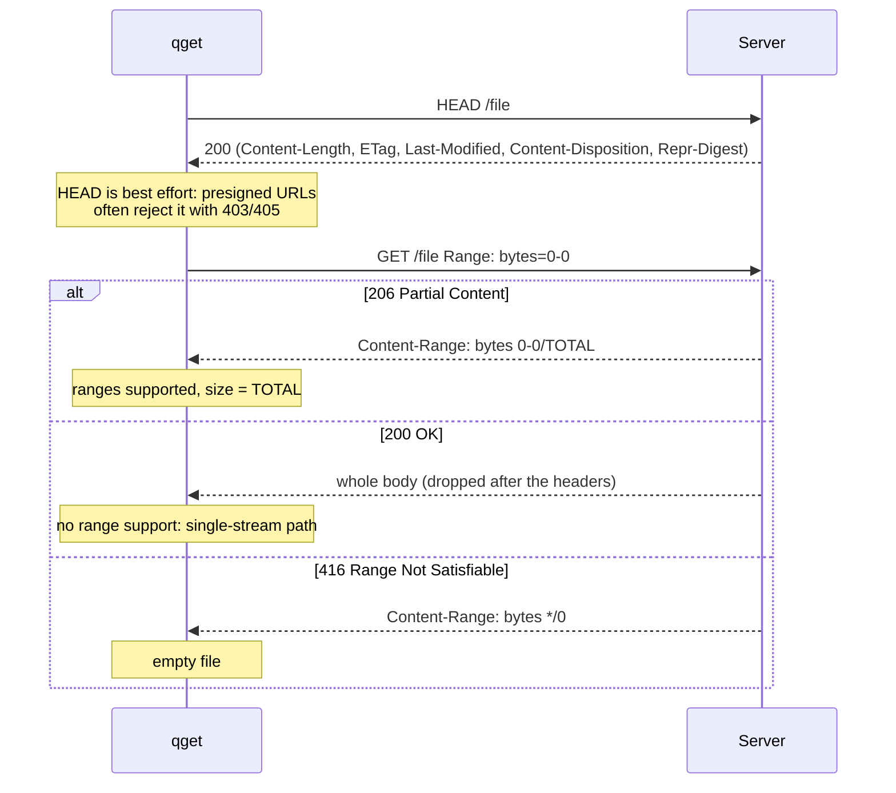

<!-- covers: crates/qget-http/src/lib.rs crates/qget-core/src/content_range.rs crates/qget-core/src/lib.rs -->

# 3. The HTTP protocol layer

`qget-http` turns a URL into a `Source`: something the engine can ask for
bytes `[start, end)`. Its job is to make sure that every byte it hands over
belongs to **the same version of the same file** at **exactly the requested
offset**. Content is only verified by hash at the end (or per 1 MiB group in
hybrid mode), so these protocol checks are what stop a misbehaving server or
CDN from silently corrupting a download.

## The HTTP client

One `reqwest` client (on hyper + rustls) is built per download with these
settings:

| Setting | Value | Why |
|---|---|---|
| Protocol | HTTP/1.1 only by default | Each range gets its own TCP connection, so parallel requests really are parallel. See [why not HTTP/2](#why-http11-by-default) |
| `Accept-Encoding` | `identity` | Byte ranges must refer to the stored bytes. With transparent gzip, offsets would refer to a different representation |
| `User-Agent` | `qget/<version>` | Honest by default (CLI-08); `-U` overrides it |
| Redirects | up to 10 | Signed redirect targets are followed; the final URL is reused for range requests |
| Connect timeout | 10 s | Per connection attempt |
| Keep-alive pool | 64 idle per host, 60 s idle timeout | Connections are reused between consecutive blocks |
| `TCP_NODELAY` | on | Small request headers go out immediately |
| Proxy | environment variables; `--proxy` overrides | |
| TLS | rustls with certificate verification | `--no-check-certificate` disables it and prints a warning on every run |

With `--http2`, qget builds **16 independent clients** and hands them out
round-robin, so each parallel connection is still a separate TCP stream (and
HTTP/2 adaptive flow-control windows are enabled). `--http3` uses HTTP/3 with
prior knowledge; it only exists in builds with the `http3` feature and has not
been tested against a real HTTP/3 server.

## Probing

Before downloading, qget learns what the server will do. `HttpClient::probe`:



| Response to `bytes=0-0` | Result |
|---|---|
| `206` with `Content-Range: bytes 0-0/N` | Ranges supported, size N |
| `206` with any other `Content-Range` | Error: unsupported (exit 11) |
| `200` | Ranges not supported; size from `Content-Length` if present |
| `416` with `bytes */N` | Size N (an empty file answers this way) |
| Any other status | Error: HTTP status (exit 4) |

The probe also collects, preferring the HEAD response and falling back to the
GET:

- the **final URL** after redirects (range requests go there directly);
- the **validator**: the strong ETag and Last-Modified;
- the **filename** from `Content-Disposition` (`filename*=` is preferred over
  `filename=`, percent-decoded, reduced to its last path component; `.`,
  `..` and control characters are rejected);
- a **digest** from `Repr-Digest` or `Content-Digest` (RFC 9530, SHA-256 or
  SHA-512, base64), used as the expected checksum.

## Validators: proving it's the same file

A `Validator` holds a **strong** ETag and a Last-Modified date. Weak ETags
(`W/"…"`) are discarded on purpose: RFC 9110 forbids using them for range
requests, because a weak ETag only promises "semantically equivalent", not
"byte-identical".

Comparing two validators (`Validator::same_as`):

1. if both have an ETag, the ETags decide;
2. otherwise, if both have Last-Modified, those decide;
3. otherwise the answer is **unknown** (`None`).

"Unknown" is treated very differently from "different": on resume it means
"cannot prove the partial data is still valid, so start over"; during a
download it means "no evidence of change, continue".

## Range requests

Every request the engine issues becomes:

```http
GET /file HTTP/1.1
Range: bytes=8388608-16777215
If-Range: "5f2c-abc123"
Accept-Encoding: identity
```

`If-Range` carries the strong ETag, or Last-Modified when there is no ETag.
It asks the server: "send me this range **only if** the file is still this
version; otherwise send the whole new file with `200`". That turns a silent
change into a visible one.

### Validating the response

Every response is checked before a single body byte is accepted. The result is
already classified for the engine as `Transient` (retry, maybe elsewhere),
`Throttled` (back off and reduce load), or `Fatal` (stop using this source):

| Response | Checks | Classification |
|---|---|---|
| `206` | `Content-Range` must equal the requested range exactly and its total must equal the known size; `Content-Length`, if present, must equal the range length; the validator (ETag, else Last-Modified), if present, must not differ from the probe's | OK → stream the body |
| `206`, total size differs | | **Fatal: remote changed** |
| `206`, validator differs (server ignored `If-Range`) | | **Fatal: remote changed** |
| `206`, wrong range or wrong `Content-Length` | | Transient |
| `200`, validator differs | `If-Range` failed: the file changed | **Fatal: remote changed** |
| `200`, request was the whole file | Equivalent to a full response | OK → stream the body |
| `200`, request was a sub-range | The server ignored `Range`. The body is **never** stitched into the file | Transient |
| `429`, `503` | `Retry-After` in seconds (capped at 300 s); an HTTP-date counts as 5 s | Throttled |
| `416` | The resource shrank | **Fatal: remote changed** |
| `403` with `--refresh-cmd` (at most 5 times per source) | Run the command; accept the new URL only if size and validator match | Transient (retry with the new URL), or Fatal 403 if the refresh fails |
| `408`, `5xx` | | Transient |
| Any other status (`404`, `401`, `403` without refresh…) | | Fatal: HTTP status |
| Connection error | | Transient |

Note the asymmetry: a source is only disabled by **evidence** (a changed
validator, a wrong size, a hard status), never by a timeout or reset.

### Checking the body

After the headers are accepted, the runtime enforces the byte count while
streaming (`fetch_task` in `qget-runtime/src/driver.rs`):

- a body that ends before the requested end is a transient failure ("body
  ended early"), and only the bytes actually received are kept;
- a chunk that would extend **past** the requested end is a transient failure
  ("server sent more bytes than requested");
- no byte for 15 s (`-T`, `idle_timeout`) is a transient failure, and so is
  waiting longer than that for the response headers.

### The `Content-Range` parser

`qget-core/src/content_range.rs` is deliberately strict, because it is the
line of defence against misbehaving servers and is fuzzed (`fuzz/`):

```text
accepted   bytes 0-99/1000      bytes 5-5/*      bytes */1000   (416 only)
rejected   bytes 0-99           (no total)
           bytes 99-0/1000      (last < first)
           bytes 0-1000/1000    (last ≥ total)
           bytes 0-+9/100       (signs are not digits)
           items 0-9/100        (wrong unit)
           bytes */*            (unsatisfied without a length)
```

`ContentRange::matches(start, end, size)` then requires `first == start`,
`last + 1 == end`, and the total (if given) to equal `size`.

## Throttling and politeness

`429` and `503` are not errors to retry around. The engine treats them as a
signal to send **less** traffic: it halves its connection target once per
throttle episode and keeps that source idle for at least `Retry-After`. See
[The scheduler](04-scheduler.md#failure-handling). Opening more connections to
get around a throttle is exactly what qget avoids (NET-02).

## Why HTTP/1.1 by default

- **Parallelism needs separate TCP connections.** A single TCP connection is
  limited by its congestion window and by per-connection server limits
  (common on CDNs and object stores; AWS recommends concurrent ranged GETs on
  separate connections "to fully use your NIC"). HTTP/2 multiplexes many
  streams onto **one** TCP connection, which adds no TCP parallelism, and its
  default per-stream flow-control window is only 64 KiB.
- **HTTP/3 (QUIC) costs more CPU at the receiver.** Published measurements
  show QUIC receive paths falling well behind TCP on fast links (up to 45%
  slower above roughly 500 Mbit/s). For bulk downloads TCP is the safer
  default; QUIC is used where it is genuinely needed, for P2P NAT traversal.

## File names

Without `-O`, the output name is the last path segment of the **original**
URL, percent-decoded and sanitised to a single component (`index.html` if
there is none). `--content-disposition` uses the server's filename instead,
like `wget --content-disposition`.

Next: [The scheduler](04-scheduler.md).
