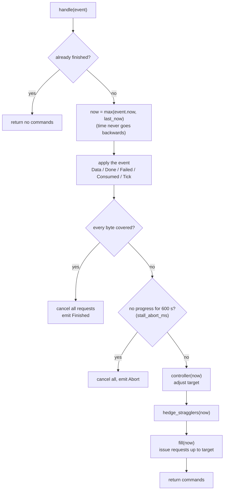
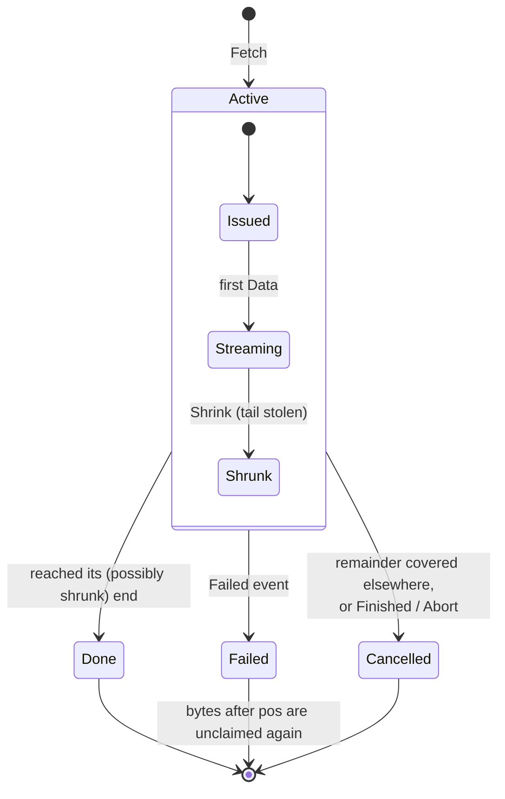
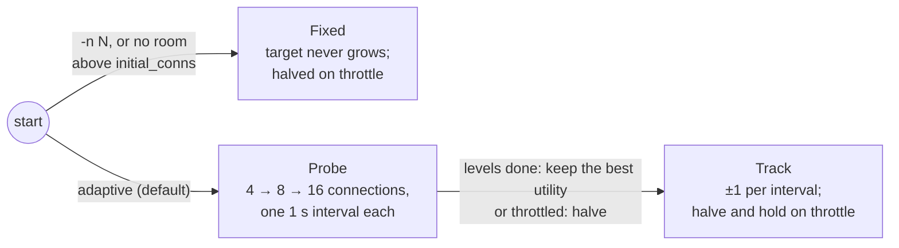
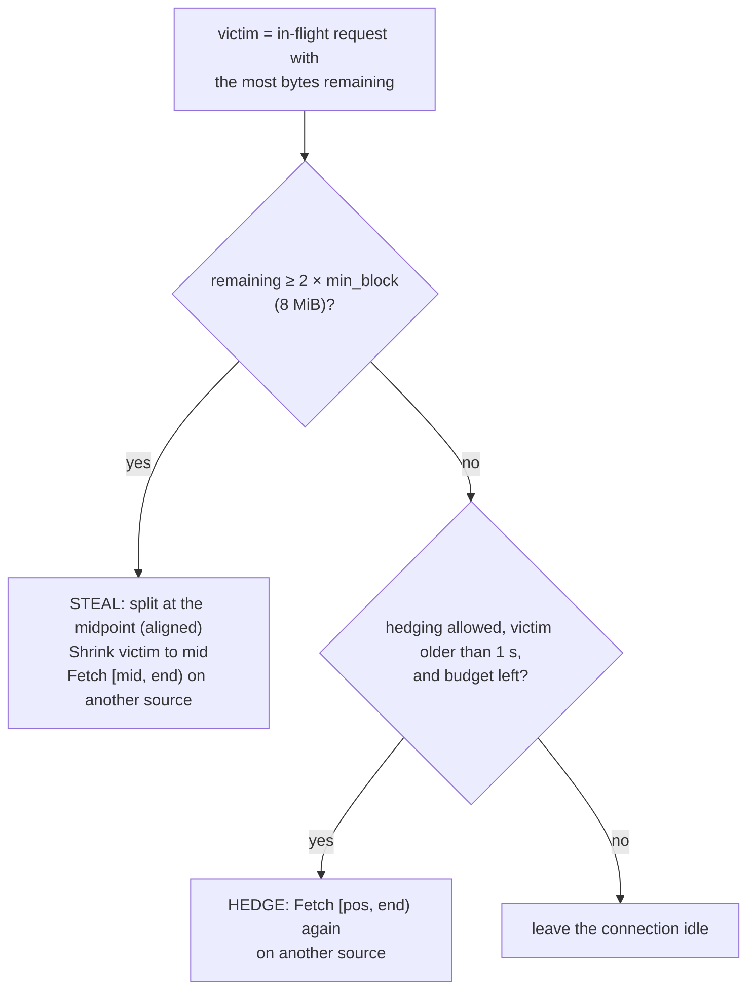

<!-- covers: crates/qget-core/src/engine.rs crates/qget-core/src/range.rs crates/qget-core/src/rng.rs -->

# 4. The scheduler

The scheduler (`qget-core/src/engine.rs`) decides everything about a
transfer: which bytes to request, from which source, how many requests to run
at once, what to do when one fails or crawls. It is a pure state machine
(see [Architecture](01-architecture.md#the-core-idea-a-pure-engine-inside-an-io-shell)),
so this document can describe it completely as **state + events → new state +
commands**.

All times are milliseconds taken from the events. All rates are **bytes per
millisecond** (1 byte/ms = 1 kB/s, so 25 MB/s is 25,000 bytes/ms).

## Interface

### Events (runtime → engine)

| Event | Sent when | Fields |
|---|---|---|
| `Tick` | Every 100 ms, and once at start | `now` |
| `Data` | A chunk from request `req` has been handed to the sink | `now, req, offset, len` |
| `Done` | Request `req` delivered its whole (possibly shrunk) range | `now, req` |
| `Failed` | Request `req` ended with a classified failure | `now, req, kind: FailKind` |
| `Consumed` | Streaming mode: the consumer has taken every byte before `head` | `now, head` |

### Commands (engine → runtime)

| Command | Meaning |
|---|---|
| `Fetch { req, source, range }` | Start a new request for `range` on `source` |
| `Shrink { req, end }` | Stop request `req` when it reaches `end`; its tail now belongs to another request |
| `Cancel { req }` | Stop request `req` now; its remaining bytes are no longer needed |
| `Finished` | Every byte is present |
| `Abort { kind, msg }` | Give up; `kind` decides the exit code |

### Failure kinds

| `FailKind` | Examples | Engine reaction |
|---|---|---|
| `Transient(msg)` | Reset, timeout, short body, 5xx, wrong `Content-Range` | Back off this source briefly; retry the bytes elsewhere or later |
| `Throttled { retry_after_ms }` | 429, 503 | Cool this source down; halve the connection target |
| `Fatal { kind, msg }` | 404, remote changed, BLAKE3 mismatch | Disable this source for the rest of the run |

## State

```text
Engine
├── coverage        IntervalSet of bytes received (merged, sorted spans)
├── inflight        ReqId → Req  (ordered map, so iteration is deterministic)
│   └── Req { source, pos, end, started, sample_at, sample_bytes,
│             rate: EWMA bytes/ms, hedged: bool }
├── sources[i]      { enabled, cooldown_until, backoff_level, throttle_level,
│                     inflight, rate: EWMA bytes/ms, interval_bytes }
├── target          connections the controller wants right now
├── phase           Probe | Track | Fixed   (concurrency controller)
├── head            streaming consumer position
├── hedge_used      bytes requested twice so far
├── consecutive_failures, last_progress, throttle_episode_until, no_increase_until
├── rng             SplitMix64 seeded from the config
└── stats           counters for --explain
```

`Req.pos` is the next byte expected from that request and `Req.end` is where
it stops. The bytes `[pos, end)` are *claimed*: no other request is given them
unless the engine deliberately steals or hedges.

## What `handle` does, in order

Every event goes through the same fixed sequence. The order matters and is
part of what makes runs reproducible.



### Applying `Data`

1. Insert `[offset, offset + len)` into `coverage`.
2. Reset `consecutive_failures` to 0 and record progress.
3. Advance the request's `pos`, and update its rate estimate (below).
4. Reset that source's backoff and throttle levels: it is clearly working.
5. **Cancel redundant requests**: any in-flight request whose remaining
   `[pos, end)` is now entirely covered by other requests' data is cancelled.
   This is how the loser of a hedge race is stopped.

`Done` simply removes the request. `Consumed` moves `head` forward.

## Request lifecycle



A failed request keeps whatever it delivered before failing; only `[pos, end)`
returns to the pool and is picked up by the next `fill`.

## Allocation: `fill`

While fewer requests are in flight than `target`, `fill` issues new ones:

1. **Pick a source** (below). If every source is disabled or cooling down,
   stop.
2. **Compute the claimed set**: `coverage` plus every in-flight `[pos, end)`.
3. **Find the first gap** in the claimed set, starting at 0 (or at `head` in
   streaming mode) and ending at the file size (or `head + window`).
4. **Cut a block** from the start of that gap:
   - start = gap start rounded **down** to `alignment` (1 byte for HTTP,
     1 MiB for P2P groups);
   - end = start + block size, rounded **up** to `alignment`, capped at the
     gap end and the file size;
   - **no slivers**: if this would leave less than half a minimum block
     (2 MiB) at the end of the gap, the block is extended to the gap end.
5. Emit `Fetch` and repeat.
6. If there is **no gap** left (everything is claimed), steal from or hedge
   the request with the most bytes remaining (see
   [When everything is claimed](#when-everything-is-claimed-steal-or-hedge)).

Because gaps are taken lowest-offset first, the downloaded prefix grows
steadily. That keeps the streaming consumer and the ordered hash fed.

**Example.** A fresh 1 GiB download with defaults: the first `Tick` issues
four requests, `[0, 8)`, `[8, 16)`, `[16, 24)` and `[24, 32)` MiB, all on
source 0. As each finishes, the next gap (`[32, …)`) is cut with a block size
recomputed from the measured rate.

### Block size

```text
per_connection_rate = aggregate_rate / max(1, requests in flight)   (bytes/ms)
block = per_connection_rate × 1000           ≈ one second of transfer
block = clamp(block, min_block = 4 MiB, max_block = 64 MiB)
block = round up to 1 MiB, then to alignment
```

Before the first measurement interval completes, `initial_block` (8 MiB) is
used. The reasoning: between two blocks a connection sits idle for about one
round trip while the next request goes out. Aiming for about a second of work
per block keeps that idle gap to a few percent, while blocks stay small enough
that fast connections naturally take more of them than slow ones (dynamic
assignment, after Rodriguez & Biersack). Rounding to whole MiB means tiny
fluctuations in the measured rate do not change the decision (DET-03).

### Choosing a source

```text
for each source that is enabled and not cooling down:
    speed = measured rate (bytes/ms), or 10⁹ if not yet measured
    score = (requests in flight on it + 1) / speed
    if it is the source being stolen from or hedged (and there are others): score × 4
pick the lowest score (ties: lowest source index)
```

Load is weighed against measured speed, so a mirror that is twice as fast
gets about twice as many requests. Unmeasured sources look fast, so each new
source gets tried early.

## The concurrency controller

Running more connections helps until the bottleneck moves away from the
per-connection limit; after that, extra connections only add load on the
server and the network. The controller tries to find that knee and stay there.

### Measurement

Every `probe_ms` (1 s) the controller closes a measurement interval:

- `aggregate_rate` = bytes received in the interval / its length;
- each source's rate EWMA = ½ new + ½ old;
- if every source was cooling down, the interval counts as throttled time.

### The utility function

Each interval is scored with a utility that rewards throughput but charges
for every connection (the Falcon approach: a throughput-only objective keeps
adding connections and "overburdens both networks and storage systems"):

```text
bucket  = floor( ln(rate + 1) / ln(1.05) )      one bucket = 5% more throughput
utility = bucket × 1000 − connections × 406
```

406/1000 buckets is ln(1.02)/ln(1.05): **each connection must pay for itself
with about 2% more throughput**. Bucketing to 5% steps and using integers make
comparisons exact and immune to small timing noise.

Worked example (from the real formula):

| Connections | Throughput | Bucket | Utility |
|---|---|---|---|
| 8 | 100 MB/s | 235 | 231,752 |
| 16 | 115 MB/s | 238 | 231,504 (loses to 8) |
| 16 | 120 MB/s | 239 | 232,504 (wins) |

Doubling from 8 to 16 connections must buy roughly 17% more throughput to be
worth it.

### Phases



**Probe.** The levels are `initial_conns` doubled up to three times, capped by
`max_conns`: with defaults, **4 → 8 → 16**. Each level is held for one
interval (1 s) and its utility recorded. The level with the highest utility
wins; ties go to fewer connections. Probing stops early if the next level
exceeds the *useful cap*.

**Track.** A hill climb with step 1: after each interval, if utility did not
improve, reverse direction; then move the target one step, clamped to
`[1, max_conns]` and to the useful cap. It keeps oscillating around the best
point, which lets it follow changing conditions.

**Fixed.** `-n N`, or no room to grow: the target never grows. A throttle
still halves it, and in this phase it stays halved for the rest of the run.

**After a throttle** (Probe or Track), the target is halved and the
controller holds still (it records utility but does not move) until the
cooldown plus one interval has passed. Then normal Track steps resume.

**Useful cap.** More connections than remaining minimum-size blocks cannot
help: `useful_cap = min(max_conns, ceil(remaining bytes / min_block))`.

## Failure handling

| Kind | Effect on the source | Effect on the engine |
|---|---|---|
| **Transient** | Cool down for `200 ms × 2^level` (level capped at 5, wait capped at 5 s), ±20% jitter; level +1 | `consecutive_failures` +1; above `retry_budget` (10, `-t`) → `Abort` (exit 3) |
| **Throttled** | Cool down for `max(1 s × 2^level ± 20%, Retry-After)`, capped at 30 s before `Retry-After`; level +1 | Once per throttle episode: **halve the target** (min 1); an adaptive controller moves to Track and holds until the cooldown plus one interval has passed |
| **Fatal** | Disabled for the rest of the run | If every source is disabled → `Abort` with this fatal kind |

Any received byte resets both backoff levels of that source and the global
failure counter, so a flaky but working source keeps being used. The jitter
comes from the seeded RNG, so it is reproducible.

Two more ways to give up:

- **Stall**: no byte for 600 s (`stall_abort_ms`) → `Abort`. (Individual
  requests time out much sooner, after 15 s, in the runtime.)
- **Retry budget**: more than `retry_budget` consecutive failures without any
  progress in between.

## When everything is claimed: steal or hedge

Near the end of a download every byte is either received or assigned. Idle
connections would wait for the slowest request, so the engine gives them work
taken from the request with the most bytes remaining (among those not already
split or duplicated, and inside the window):



- **Steal** costs nothing extra: each byte is still fetched once. The victim is
  marked so it is not split again.
- **Hedge** fetches the same bytes twice, so it is limited:
  - only after the victim has had half the straggler grace period (1 s) to
    finish on its own (the "hedge after a delay" rule from *The Tail at
    Scale*);
  - total duplicated bytes ≤ `hedge_budget` (5% of the file, at least 8 MiB);
  - never with `--polite`;
  - a hedge is never hedged again.
- Whichever copy delivers the bytes first wins; the other is cancelled by the
  redundancy rule in `Data` handling as soon as its remaining range is covered.

## Straggler detection

A request can be slow long before the end of the file (a bad route, a
throttled backend node). `hedge_stragglers` runs on every event:

1. Consider requests that have run for at least the grace period (2 s).
2. Estimate each one's rate. The per-request estimate is an EWMA updated at
   most every 250 ms (`0.3 × new + 0.7 × old`), and it **decays** when the
   request goes silent: after 500 ms without data, the rate since the last
   sample replaces it if lower. A stalled request is therefore seen as slow
   quickly, not when its old average finally drops.
3. Take the **median** of those rates (at least two needed). The median, not
   the mean, so a few very fast connections don't make everyone else look
   slow.
4. A request is a straggler if its rate is below **0.3 × median**, or below
   **0.5 × median** if it is the request blocking the streaming consumer's
   head.
5. Each straggler gets the steal-or-hedge treatment above. One request above
   the target is allowed for this, since the straggler will shrink or be
   cancelled soon.

## Streaming mode: the window

With a streaming sink (stdout or `--extract`), bytes can only be consumed in
order and are held in memory until then. The engine therefore only allocates
inside **`[head, head + window)`**, where `window` is `--max-buffer` (default
1 GiB) and `head` is the consumer's position from `Consumed` events.

- If the consumer falls behind, the window stops moving, `fill` finds no gap,
  and downloading ahead pauses. That is the backpressure path; memory stays
  bounded by the window.
- Requests covering the head are hedged more eagerly (0.5 × median instead of
  0.3), because every other byte is waiting for them.

## Termination

- **Finished**: as soon as `coverage` contains `[0, size)`. Remaining requests
  (duplicates, stolen halves) are cancelled in the same step.
- **Abort**: retry budget exhausted, all sources fatal, or stalled for 600 s.
- After either, `handle` returns nothing for any further event.

## Statistics

The engine counts what it did, and `--explain` prints it: requests, retries,
cancels, steals, hedges, hedged bytes, throttle responses, throttled time,
the probe results `(connections, bytes/s)`, the peak and final target, and
bytes per source.

## Known limitations

These are properties of the current implementation, recorded so they are not
mistaken for intended behaviour:

- **Stolen and cancelled requests drop their connection.** When a request is
  shrunk or cancelled, the runtime stops reading its response body. An HTTP/1.1
  connection with an unread body cannot be reused, so the next request on that
  slot pays a new TCP and TLS handshake.
- **One request per connection at a time.** There is no pipelining, so each
  block boundary costs about one round trip of idle time. The ~1 s block size
  keeps this small but not zero.
- **Slow ramp-up.** With defaults, reaching 16 connections takes about three
  seconds of probing. On short downloads this is a large share of the run, and
  it is one reason plain downloads currently trail tuned aria2c in the loopback
  benchmarks (see [How qget compares](11-comparison.md)).
- **The hill climb can walk itself down to one connection.** The nightly
  simulation sweep currently fails on seed 14668: probing behaves (4 → 8 → 16
  connections, throughput rising at each level), there is no throttling, yet
  the Track phase steps the target down to 1 and the simulated download does
  not finish within an hour. The run saw 369 transient failures; one
  hypothesis, not yet confirmed, is that failures lower an interval's
  measured throughput and the climb reads that as "fewer connections are
  better". The seed reproduces exactly:
  `QGET_SIM_SEEDS=15000 cargo test --release -p qget-core seed_sweep`
  (see [Determinism and testing](09-determinism-and-testing.md)).

Next: [The event loop](05-event-loop.md).
