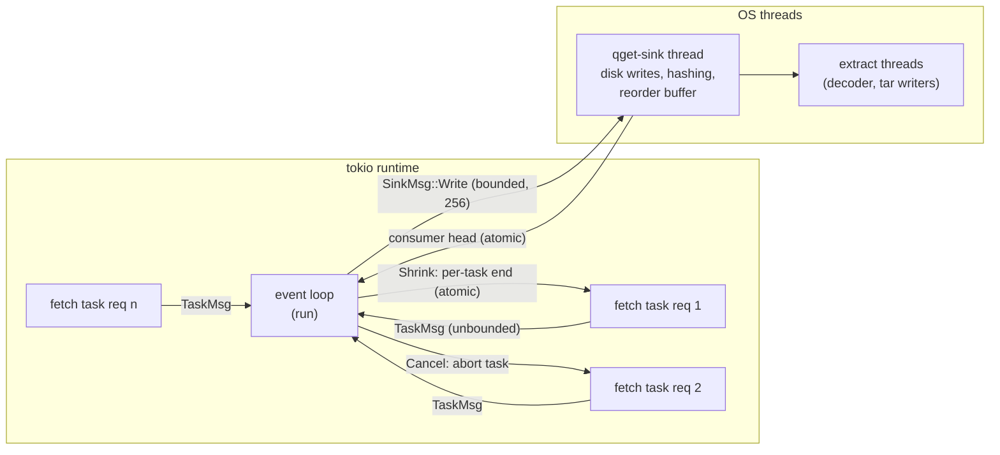
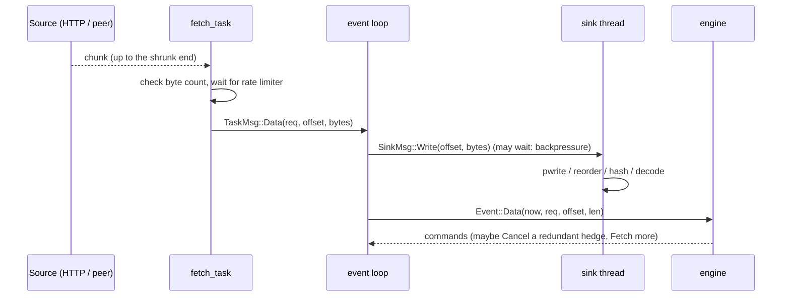

<!-- covers: crates/qget-runtime/src/driver.rs crates/qget-runtime/src/limiter.rs -->

# 5. The event loop

The engine only *decides*. `qget_runtime::run` (`qget-runtime/src/driver.rs`)
is the code that *does*: it runs network requests, moves bytes to the sink,
keeps time, and turns everything that happens into events for the engine.
This is the only place where the engine meets the real world.

## Who runs where



| Piece | What it is | Why |
|---|---|---|
| Event loop | One async function | Owns the engine; the only place events are created, so their order is well defined |
| Fetch tasks | One tokio task per engine request | Network I/O runs concurrently without blocking the loop |
| Sink thread | One dedicated OS thread, `qget-sink` | Disk writes, hashing and decompression are blocking and CPU-heavy; they must never stall the loop or the network |
| `TaskMsg` channel | Unbounded mpsc, tasks → loop | Tasks never block on the loop |
| `SinkMsg` channel | Bounded to 256 chunks, loop → sink | **Backpressure**: when the disk or decoder falls behind, the loop waits here, tasks stop being polled, and TCP flow control slows the senders |
| `end` per task | `AtomicU64` shared with the task | Lets `Shrink` move a request's end while it runs |
| `consumed` | `AtomicU64` written by the sink thread | Streaming sinks report how far the consumer has read; it becomes a `Consumed` event |

## The loop, step by step

```text
pending_events = [Tick { now: 0 }]
loop:
    for each event in pending_events:
        commands = engine.handle(event)
        record (event, commands) in the trace, if --trace
        execute each command:
            Fetch    → spawn fetch_task(req, source, range)
            Shrink   → store the new end in that task's atomic
            Cancel   → abort that task
            Finished → outcome = Ok
            Abort    → outcome = Err(kind → error)
        if outcome: leave the loop

    wait for the first of (checked in this order):
        1. cancellation token     → outcome = Interrupted; leave
        2. a TaskMsg from a task  → turn it into an event (below)
        3. the 100 ms ticker      → Consumed (if the head moved), Tick, progress callback
```

The `select!` is `biased`, so the checks happen in that order every time:
cancellation always wins, and data is preferred over ticks.

### Turning task messages into events

| Message | Action |
|---|---|
| `Data { req, offset, bytes }` | If `req` was cancelled, drop the bytes. Otherwise send them to the sink thread (waiting if its queue is full; the wait is added to `sink_wait`), then queue `Event::Data` with the current time |
| `Done { req }` | If `req` is still tracked, queue `Event::Done` |
| `Failed { req, kind }` | If `req` is still tracked, queue `Event::Failed` |

Note the order inside `Data`: bytes go to the sink **before** the engine hears
about them. The engine's coverage therefore means "handed to the sink", not
"durable on disk". Durability is entirely the sink's responsibility (see
[Durability](06-durability-and-resume.md)); the engine never needs to know
about it, which is what keeps it pure.

## One chunk's journey



## A fetch task

`fetch_task` runs one request from start to end:

1. **Open** the range on its source. If no response arrives within the idle
   timeout (15 s, `-T`), fail with `Transient("timed out waiting for response")`.
   Protocol-level validation (status codes, `Content-Range`) already happened
   inside the source; see [HTTP](03-http.md#validating-the-response).
2. **Read chunks** in a loop, each with the same idle timeout:
   - stop successfully once the position reaches the current `end` (which a
     `Shrink` may have lowered);
   - a chunk that would run past the **original** end means the server sent
     more than asked: `Transient`;
   - never deliver bytes beyond the current `end`;
   - the body ending before `end`: `Transient("body ended early")`;
   - wait for the rate limiter, if `--limit-rate` is set;
   - send `TaskMsg::Data` with the absolute offset.
3. **Report** `Done` or `Failed(kind)`.

`Cancel` aborts the task outright. Dropping the response mid-body also drops
its connection, which is the cost noted in
[the scheduler's known limitations](04-scheduler.md#known-limitations).

## Rate limiting

`--limit-rate` installs one token bucket shared by every connection
(`limiter.rs`): it refills at the configured rate, holds at most one second's
worth of tokens, and each chunk waits until enough tokens are available. The
limit applies to the download as a whole, not per connection, so the engine's
concurrency decisions are unaffected; it simply measures a lower throughput.

## Ending the run

When the loop exits, every remaining task is aborted, the sink channel is
closed, and the sink thread is joined. Then exactly one of these happens:

| Situation | Sink call | Result |
|---|---|---|
| The sink thread reported an error | `abort()` | That error |
| Engine said `Finished` | `finish()` (and `abort()` if finishing fails) | The sink's report, or its error |
| Engine said `Abort`, or the user cancelled | `abort()` | The abort error, or `Interrupted` (exit 8) |
| The loop ended for any other reason | `abort()` | `Network("download loop ended unexpectedly")` |

`abort()` on a `FileSink` commits pending ranges to the journal, so an
interrupted download resumes from as close to where it stopped as possible.
`finish()` is where verification and the atomic rename happen.

### Cancellation from a library

An embedding program cancels a download by cancelling the `CancellationToken`
passed to `Download::cancel_token` (this is what Ctrl-C does in the CLI). It can
also simply drop the future returned by `run()`: fetch tasks then stop at their
next chunk because the loop's receiver is gone, and the sink thread exits when
its channel closes. In both cases the journal only describes durable data, so
the download stays resumable (LIB-05).

## Metrics the loop collects

| Metric | Meaning | Used for |
|---|---|---|
| `bytes_received` | Every byte delivered by tasks, including duplicates | Summary, overhead in `--explain` |
| `resumed_bytes` | Coverage that existed before the run | Summary |
| `sink_busy` | Time the sink thread spent inside `write` | Bottleneck analysis |
| `sink_wait` | Time the loop spent waiting for space in the sink queue | Bottleneck: disk- or decode-bound |
| Progress callback | Every tick: bytes covered, total, rate, connections, target, elapsed | Progress bar and `--progress=json` |

Next: [Durability and resume](06-durability-and-resume.md).
