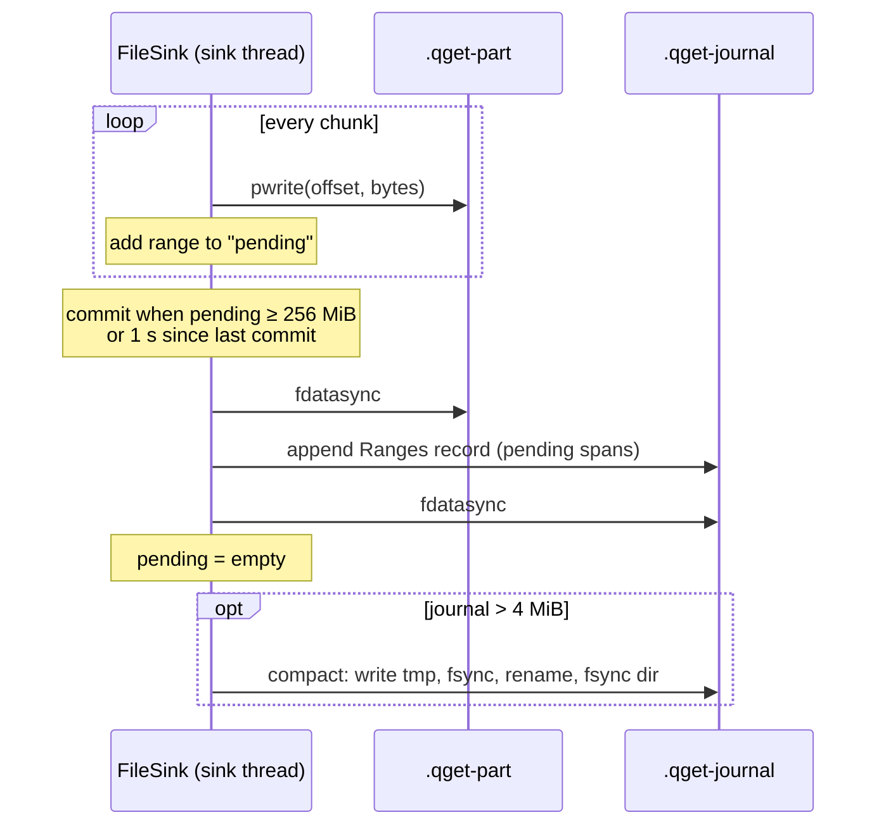
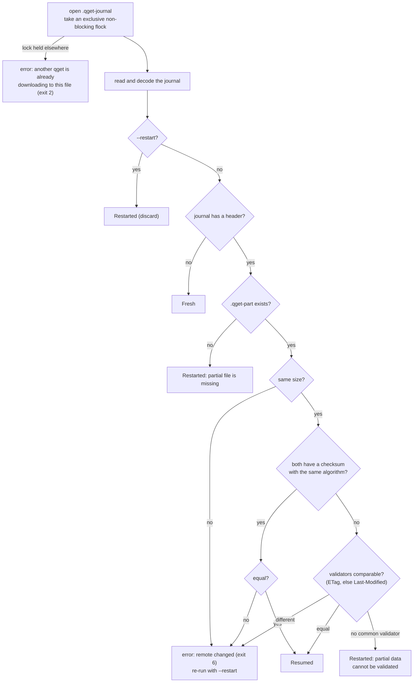
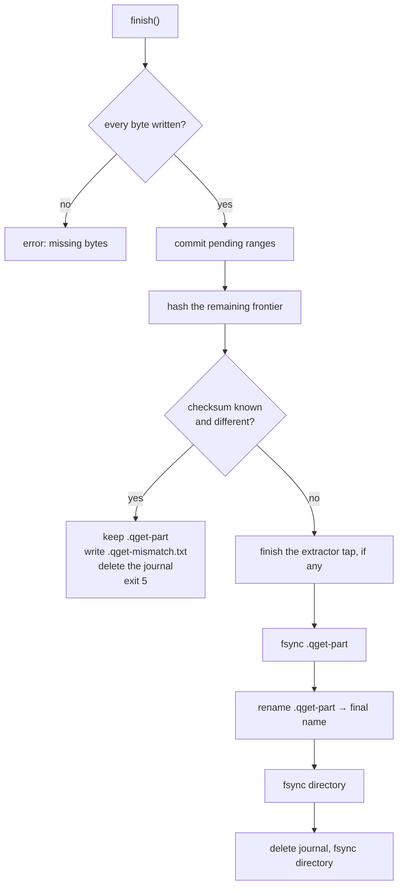

<!-- covers: crates/qget-runtime/src/file_sink.rs crates/qget-runtime/src/fsutil.rs crates/qget-core/src/journal.rs -->

# 6. Durability and resume

A download of hundreds of gigabytes will be interrupted: by Ctrl-C, `kill -9`,
an OOM kill, a reboot, a power cut. qget's promise (G1, DUR-06) is that you
can re-run the same command after **any** of these, at **any** instant, and
the result is either byte-exact or a clear error. Never a silently corrupted
file.

This document covers the `FileSink` (`qget-runtime/src/file_sink.rs`), the
journal format (`qget-core/src/journal.rs`) and the filesystem rules they
follow (`qget-runtime/src/fsutil.rs`).

## Files on disk

For an output `chain.tar.lz4`:

| File | Exists | Contents |
|---|---|---|
| `chain.tar.lz4.qget-part` | While downloading | The output, preallocated to full size, filled in any order |
| `chain.tar.lz4.qget-journal` | While downloading | Which byte ranges of the part file are durable, plus the identity of the remote file |
| `chain.tar.lz4.qget-journal.qget-tmp` | Briefly, during journal compaction | The new journal before it is renamed into place |
| `chain.tar.lz4.qget-mismatch.txt` | After a checksum mismatch | URL, expected and actual hash, where the data was kept |
| `chain.tar.lz4` | Only after success | The verified file, renamed from `.qget-part` |

The final name appears **only** through a rename that happens after
verification. A file with the final name is therefore always complete.

## The core invariant

> **The journal never claims a byte that is not durable on disk.**

Everything else follows from it. After a crash, the journal may claim *less*
than what is really on disk (those bytes are fetched again, harmlessly), but
never more. So resuming from the journal can never splice garbage into the
file.

## Write ordering



1. `pwrite` the chunk at its offset (writes may arrive in any order).
2. Add the range to the **pending** set.
3. When 256 MiB are pending or 1 s has passed since the last commit
   (`commit_bytes`, `commit_interval`; checked on each write), **commit**:
   1. `fdatasync` the part file, so every pending byte is on stable storage;
   2. append one `Ranges` record listing the pending spans;
   3. `fdatasync` the journal.

The data `fdatasync` must come **before** the journal append. Filesystems
reorder writes freely between files, so without it a crash could persist the
journal record while the data it describes is still in the page cache (the
class of bug catalogued by Pillai et al., *All File Systems Are Not Created
Equal*, OSDI 2014).

Committing in groups instead of per chunk is what makes this affordable: one
`fdatasync` per 256 MiB or per second, not per 16 KiB packet. The cost is that
up to one commit's worth of data may be fetched again after a crash.

## The journal format

```text
offset 0   "QGETJNL\x01"                       8-byte magic (version 1)
           record, record, record, …

record     ┌──────────────┬─────────────────┬──────────────────────┐
           │ len: u32 LE  │ crc32c: u32 LE  │ payload (len bytes)  │
           └──────────────┴─────────────────┴──────────────────────┘
           crc32c is computed over the payload only

payload    tag: u8, then
  tag 1  Header   size: u64
                  etag: opt_str            strong ETag, quotes included
                  last_modified: opt_str
                  url: str                 final URL after redirects
                  expected: opt_str        e.g. "sha256:9f2c…"
  tag 2  Ranges   n: u32, then n × (start: u64, end: u64)   half-open spans

str      = len: u32 LE, UTF-8 bytes
opt_str  = 0x00 (absent) | 0x01 str
all integers little-endian
```

A journal is the magic, exactly one `Header` record, then any number of
`Ranges` records. Coverage is the union of all `Ranges`.

### Decoding rules

The decoder reads records until the first one that fails **any** check, and
trusts everything before it:

- length is 0, larger than 64 MiB (`MAX_RECORD`), or runs past the end of the
  file → stop (a torn tail);
- CRC32C does not match → stop (a torn or corrupted record);
- unknown tag, or bytes left over inside the payload → stop;
- a second `Header`, or a `Ranges` record before any `Header` → stop;
- spans outside `[0, size)` or with `start ≥ end` are dropped.

It returns the header, the coverage, and `valid_len`: the byte offset where the
trusted prefix ends. On resume, the file is truncated to `valid_len` before
anything new is appended, so a torn record never sits in the middle of a
journal. The decoder is property-tested to never panic on arbitrary input and
has a fuzz target.

### Compaction

A long download appends many small records. When the journal grows past
4 MiB, it is replaced by a snapshot: magic, header, and one `Ranges` record
holding the merged coverage. The replacement is atomic: write
`.qget-journal.qget-tmp`, `fsync` it, rename it over the journal, `fsync` the
directory. A crash at any point leaves either the old or the new journal, both
valid.

## Opening: the resume decision

`FileSink::open` runs before any byte is downloaded:



Two outcomes deserve attention:

- **Remote changed is an error, not a silent restart.** If the file on the
  server changed, a fresh download is very likely what you want, but qget
  stops and says so, because the change may be a mistake on the server
  (a half-uploaded snapshot, a CDN serving a stale node). `--restart`
  discards the partial data explicitly.
- **No validator means no resume.** If the server sends neither an ETag nor a
  Last-Modified and no checksum was given, there is no way to prove the
  partial bytes belong to the current file, so they are discarded. Resuming
  blindly is exactly the silent corruption qget exists to prevent.

After the decision:

1. Open `.qget-part`, truncating it unless resuming.
2. **Check disk space**: bytes still to allocate (size minus blocks already
   allocated) plus a 16 MiB margin must be available, or fail now with
   "disk full" (exit 7) instead of at 90% (DUR-08).
3. **Preallocate** the whole file with `fallocate` (Linux, FreeBSD). Where
   the filesystem can't (some FUSE and tmpfs mounts, and macOS), extend the
   file sparsely instead (DUR-07).
4. Prepare the journal:
   - **resuming**: truncate any torn tail to `valid_len` and `fsync`;
   - **fresh or restarted**: write magic + header, `fsync` the journal,
     `fsync` the part file, `fsync` the directory (so both files are
     guaranteed to exist after a crash).
5. Return the coverage to the engine, which only requests the missing bytes.

The lock is an `flock` on the journal file and is released automatically when
the process exits, however it exits.

## Hashing while downloading, even when resuming

If an expected checksum is known, the sink hashes the file **in order** as it
fills:

- a write that starts exactly at the hashed frontier is hashed straight from
  memory;
- otherwise, once the gap before it fills, the newly contiguous bytes are
  **read back from the part file** and hashed, at most 64 MiB per write so a
  large backlog does not stall writing.

On resume the frontier starts at byte 0, so the bytes from the previous run
are read back and hashed too. The final hash therefore covers the whole file
as it is on disk, not just this run's bytes. The same ordered feed drives the
extractor in `--keep-archive` mode (see
[Streaming and extraction](07-streaming-and-extraction.md)).

## Finishing



On a mismatch the journal is deleted on purpose: the next run must not resume
from data that is known to be wrong. The part file is kept for inspection.

## What happens if you crash here?

| Crash point | State on disk | Next run |
|---|---|---|
| Before the first journal header is durable | Journal empty or torn | No header → fresh download |
| After `pwrite`, before the data `fdatasync` | Some bytes may or may not be on disk; none journaled | Those ranges are fetched again and overwritten |
| After the data `fdatasync`, before the journal append | Bytes durable but not recorded | Fetched again (wasted, harmless) |
| During the journal append | Torn last record | CRC/length check discards it; journal truncated to the last good record |
| After the journal `fdatasync` | Ranges durable and recorded | Resumed, not fetched again |
| During compaction | Old journal, or new journal, plus maybe a stale `.qget-tmp` | Either journal is valid; the tmp file is overwritten next time |
| After verification, before the rename | Complete `.qget-part` + journal | Engine finds everything covered and finishes immediately; the file is re-hashed from disk and renamed |
| After the rename, before the journal is deleted | Final file + stale journal, no part file | "Partial file is missing" → the file is downloaded again. Correct, but wasteful |
| After a checksum mismatch | Part file, no journal | Fresh download |

The `kill -9` test in `qget-cli/tests/cli.rs` kills a real download at random
moments, re-runs it, and compares the result byte for byte. CI runs 6 kills on
every push (`QGET_CRASH_ROUNDS` raises it); the nightly job runs 200.

## Other output paths

- **Single-stream downloads** (no range support) write a `.qget-part` with a
  buffered writer and rename it on success, with the same `fsync` + directory
  `fsync`. There is no journal: such servers can't resume anyway.
- **Streaming extraction without `--keep-archive`** has no part file and no
  journal; it is not resumable. Its own durability rules (staging directory,
  one `syncfs`, atomic rename) are in
  [Streaming and extraction](07-streaming-and-extraction.md#staging-and-install).
- **P2P receives** use the same `FileSink`. The journal header stores the
  BLAKE3 root as a pseudo-ETag (`"b3:<root>"`) and the expected hash as
  `blake3:<root>`, so resume works exactly as above.

Next: [Streaming and extraction](07-streaming-and-extraction.md).
