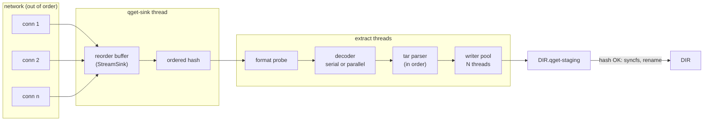
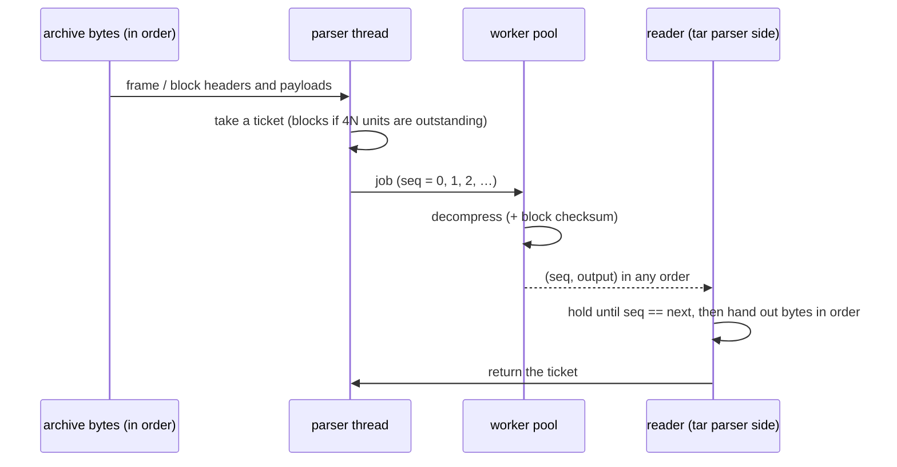

<!-- covers: crates/qget-runtime/src/stream_sink.rs crates/qget-extract/src/lib.rs crates/qget-extract/src/decode.rs crates/qget-extract/src/format.rs crates/qget-extract/src/tarw.rs crates/qget-extract/src/platform.rs -->

# 7. Streaming and extraction

`qget URL --extract DIR` downloads a `.tar`, `.tar.lz4`, `.tar.zst`,
`.tar.gz` or `.tar.xz` archive over many parallel connections and extracts it
**while it downloads**. The archive is never stored. Compared with the usual
"download, then `tar -x`", this needs half the disk space and overlaps the two
slowest steps instead of running them one after the other.

The hard part is that parallel downloading produces bytes **out of order**,
while decompression and tar parsing need them **in order**. This document
explains how qget bridges the two with bounded memory, and how it extracts
safely.

## The pipeline



| Stage | Thread(s) | Bounded by |
|---|---|---|
| Engine allocation | event loop | Only bytes in `[head, head + window)` are requested; `window = --max-buffer` (default 1 GiB, minimum 64 MiB) |
| Reorder buffer | `qget-sink` | Holds out-of-order chunks until the gap before them fills; at most the window |
| Extractor input | channel to `qget-extract` | 128 chunks |
| Parallel decoder | `qget-decode-parse` + N `qget-decode-i` workers | 2N queued jobs, 4N decoded-but-unread units |
| Writer pool | N `qget-write-i` threads | 32 queued files per writer |

N is the number of CPUs, clamped to 2..32. Library users can set it with
`Download::extract_threads`; the CLI uses the default.

### Backpressure, end to end

Every queue above is bounded, so a slow stage slows everything upstream
instead of filling memory:

1. The disk is slow → writer queues fill → the tar parser blocks.
2. The parser stops reading → decoded units pile up to the ticket limit → the
   decode parser blocks.
3. The decoder stops reading → the extractor's input channel fills →
   `StreamSink::write` blocks on the sink thread.
4. The sink thread stops → the event loop's 256-chunk sink queue fills → the
   loop waits → fetch tasks are not polled → TCP flow control slows the
   servers.
5. Meanwhile the consumer's `head` stops moving, so the engine's window stops
   moving and no new ranges are requested.

Memory use is therefore roughly the window plus the fixed queue sizes, no
matter how large the archive is (PERF-06).

## The reorder buffer

`StreamSink` (`qget-runtime/src/stream_sink.rs`) keeps a map from offset to
chunk and a `head`, the number of bytes already delivered:

```text
write(offset, data):
    if the chunk ends at or before head: ignore it (a duplicate)
    store it at its offset (if a chunk already starts there, keep the longer one)
    drain:
        while the lowest stored chunk starts at or before head:
            deliver only its bytes beyond head (overlap from hedges is trimmed)
            feed them to the hash and the consumer
            head = end of that chunk
```

Hedged requests can deliver the same bytes twice; trimming at `head` makes
that harmless. The sink reports `head` back to the engine as
`Event::Consumed`, which is what moves the allocation window.

## Integrity in streaming mode

The reorder buffer hashes bytes in order as it delivers them. At the end, the
hash is compared **before** the consumer is told to finish:

- **extraction**: a mismatch aborts the extractor, which leaves the staging
  directory in place and never renames it to `DIR`;
- **stdout**: the bytes have already gone down the pipe, so the mismatch can
  only be reported (exit 5).

Because a checksum matters so much here, `--extract` also looks for a
`<url>.sha256` or `<url>.sha512` sidecar automatically (see
[the lifecycle](02-download-lifecycle.md#step-3-finding-the-expected-checksum)).
The checksums built into LZ4 and zstd frames are verified too, but they detect
corruption, not tampering: anyone who can change the archive can recompute
them.

## Format detection

The first 64 KiB are buffered, inspected, then replayed to the decoder.
Detection uses magic bytes, never the file extension (EXT-01):

| Format | Recognised by |
|---|---|
| LZ4 frame | `04 22 4D 18` (`0x184D2204`, little-endian) |
| zstd frame | `28 B5 2F FD` (`0xFD2FB528`) |
| (either) | Skippable frames `0x184D2A50`–`0x184D2A5F` before the first real frame are skipped; pzstd and seekable-zstd archives start with them |
| gzip | `1F 8B` |
| xz | `FD 37 7A 58 5A 00` |
| tar | `ustar` at offset 257, or a valid header checksum in the first 512 bytes |

`--format` overrides detection.

## Decode plans

| Format | Plan | Why |
|---|---|---|
| tar | none | |
| tar.lz4, independent blocks | **parallel**, one job per LZ4 block | Independent blocks (the `lz4` CLI default) can be decompressed in any order |
| tar.lz4, linked blocks (`lz4 -BD`) | serial | Each block depends on the previous one |
| tar.zst, frames ≤ 64 MiB | **parallel**, one job per frame | zstd frames are independent. Multi-frame output from `zstd -T`, `pzstd` or seekable zstd has many frames |
| tar.zst, a frame > 64 MiB | serial from that point on | Buffering a huge frame to decode it elsewhere would cost memory without gaining parallelism; a single-frame archive decodes at single-core speed |
| tar.gz | serial (multi-member aware) | Deflate streams can't be split without an index |
| tar.xz | serial (multi-stream aware) | |

The plan is reported as a note (`decode: …`) and used in the bottleneck
analysis: if a serial decoder was busy for most of the run, `--explain` says
the download was decode-bound.

### Parallel decoding: the ordered decoder

Both parallel plans share one structure (`OrderedDecoder` in `decode.rs`):



1. A **parser thread** walks the compressed stream, cutting it into
   independent units (LZ4 blocks or zstd frames) without decompressing them,
   and numbers them in order.
2. **Workers** decompress units in parallel.
3. The **reader** reassembles outputs strictly by sequence number and serves
   them through a normal `Read`, so the tar parser does not know decoding was
   parallel.
4. **Tickets** cap how many units may be decoded but not yet read, which
   bounds memory.

### LZ4 frame parsing

```text
magic 0x184D2204
FLG   bits 7-6 version (must be 01)
      bit 5   block independence  (must be 1 on the parallel path)
      bit 4   block checksums present
      bit 3   content size present (8 more header bytes)
      bit 2   content checksum present
      bit 0   dictionary id present (4 more header bytes)
BD    bits 6-4 maximum block size: 4 = 64 KiB, 5 = 256 KiB, 6 = 1 MiB, 7 = 4 MiB
HC    header checksum = (xxh32(descriptor) >> 8) & 0xFF   (verified)
blocks:
      u32 size; high bit set = stored uncompressed; 0 = end of frame
      data; [u32 xxh32 block checksum]   (verified by the worker)
end:  [u32 xxh32 of the whole decoded content]   (verified in order by the reader)
```

The first frame's independence bit selects the plan. If a later frame in the
same stream turns out to be linked, decoding stops with an error rather than
producing wrong output.

### zstd frame splitting

The parser reads just enough of each frame to find its end: the frame header
descriptor (content-size field size, single-segment flag, checksum flag,
dictionary-id size), then each block's 3-byte header (last-block bit, block
type, size; RLE blocks carry one byte), then the optional 4-byte checksum.
Each complete frame becomes a job. Decoders allow windows up to 2³¹
(`window_log_max(31)`), so archives made with `zstd --long=31` work.

## Tar extraction

Tar must be parsed in order, but writing files is the slow part, so qget
splits the two (the same split Databricks' fastar uses):

- **One parser** (`tar` crate) reads entries sequentially from the decoder.
- **A pool of writers** creates files. Each path is hashed to a fixed writer,
  so if an archive contains the same path twice, the writes happen in archive
  order.
- **Files up to 4 MiB** are read into memory and handed to their writer.
- **Larger files** are written by the parser itself, after waiting for that
  writer to finish earlier work on the same path; space is reserved with
  `fallocate` first.
- **Directories** are created as they appear; their permissions and times are
  applied at the very end, deepest first, so a read-only directory doesn't
  block writing its own contents.

### Safety rules (EXT-06, SEC-03)

Archives come from the network and are treated as hostile:

| Entry | Rule |
|---|---|
| Any path | Must be relative; `..` and absolute paths are refused; at most 4096 bytes |
| Writing through a symlink | Refused: the extractor remembers every symlink it created and refuses any entry whose parent is one. Files are also opened with `O_NOFOLLOW` |
| Symlink | Its target may not be absolute and may not climb above the extraction root |
| Hard link | Its target must be inside the root and not reached through a symlink |
| Device node, FIFO | Refused; `--allow-special` skips them instead |
| Permissions | Only the `0o777` bits are kept: setuid, setgid and sticky are dropped. Ownership is not restored |
| Entry count | At most 50 million |

## Staging and install

Extraction never writes into `DIR` directly:

1. **Before downloading**, `DIR` must not exist or must be empty
   (`--extract-into-existing` allows a non-empty one). This fails fast, before
   any bytes are transferred.
2. Everything is extracted into **`DIR.qget-staging`**. A stale staging
   directory from an earlier failed run is removed first.
3. When the archive ends, any trailing bytes after the tar end-of-archive
   marker are read and discarded, so the download can complete.
4. **After the hash check passes**, the whole filesystem is flushed once with
   `syncfs` (or `sync()` outside Linux), instead of an `fsync` per file, which
   would be very slow for archives with millions of small files.
5. **Install**: rename `DIR.qget-staging` → `DIR` (an empty `DIR` is removed
   first) and `fsync` the parent directory. With `--extract-into-existing`,
   each top-level entry is moved in instead, and an entry that already exists
   in `DIR` stops the install with the staged copy kept.

If anything fails (a hash mismatch, a hostile entry, a network error), the
staging directory is left for inspection and `DIR` is untouched.

## Resumability

Plain streaming extraction is **not resumable**: there is no archive on disk
to resume from, and decompressor state can't be saved at arbitrary points. A
re-run starts over, removing the stale staging directory.

`--keep-archive` trades disk space for resumability. The archive is downloaded
through a normal [`FileSink`](06-durability-and-resume.md), and the extractor
is attached to it as a **tap**: it is fed the contiguous prefix of the file,
read back from disk as it fills. A crash then loses no downloaded bytes; on the
next run the download resumes, and extraction replays from the start of the
archive already on disk.

Next: [Peer-to-peer](08-p2p.md).
