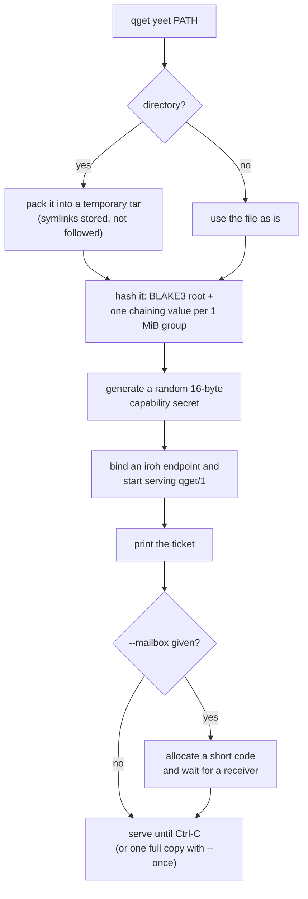
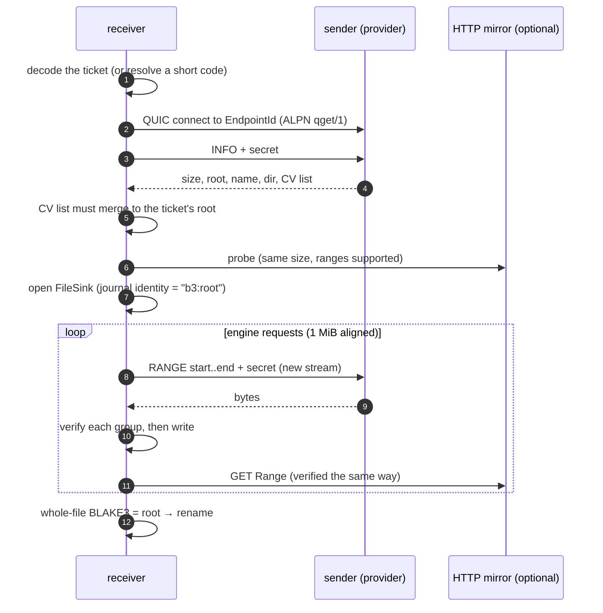
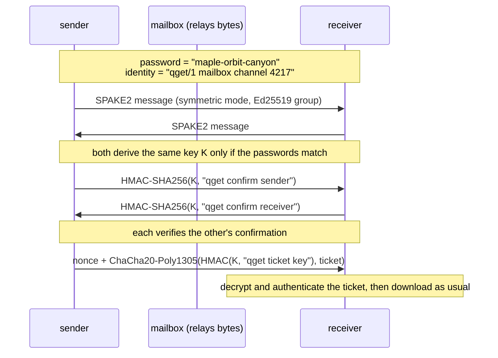

<!-- covers: crates/qget-p2p/src/net.rs crates/qget-p2p/src/ticket.rs crates/qget-p2p/src/proto.rs crates/qget-p2p/src/provider.rs crates/qget-p2p/src/source.rs crates/qget-p2p/src/pake.rs crates/qget-p2p/src/mailbox.rs crates/qget-p2p/src/words.rs crates/qget-core/src/b3tree.rs crates/qget/src/p2p_ops.rs crates/qget-cli/src/p2p.rs -->

# 8. Peer-to-peer

With the `p2p` feature (included in release binaries), qget can send a file or
directory straight to another machine, even when both are behind NAT:

```sh
qget yeet ./snapshot.tar.lz4        # sender: prints a ticket (and a short code with --mailbox)
qget yoink qget1eyJhZGRyIjp7…        # receiver
```

The receiver can pull from **several peers at once** (swarm), and from **HTTP
mirrors and peers at once** (hybrid), with every byte verified against one
BLAKE3 hash before it is written. This document explains the layers from the
bottom up.

## The layers

```text
┌──────────────────────────────────────────────────────────────────┐
│ engine + FileSink        same scheduler and journal as HTTP      │
├──────────────────────────────────────────────────────────────────┤
│ verification             every 1 MiB group checked against the   │
│                          BLAKE3 tree before release               │
├──────────────────────────────────────────────────────────────────┤
│ qget/1 protocol          INFO and RANGE requests, one QUIC       │
│                          stream each, capability secret           │
├──────────────────────────────────────────────────────────────────┤
│ iroh                     QUIC + TLS with raw public keys,        │
│                          hole punching, relay fallback            │
└──────────────────────────────────────────────────────────────────┘
```

## Connectivity: iroh

qget does not implement NAT traversal itself. It uses [iroh](https://iroh.computer)
(1.x), which provides:

- **Dial by public key.** Each endpoint has an Ed25519 key pair; its public key
  is its `EndpointId`. Connecting to an `EndpointId` authenticates the peer as
  part of the QUIC/TLS handshake, with no certificate authority involved.
- **NAT traversal inside QUIC.** Connections can start through a relay and
  move to a direct path when UDP hole punching succeeds. Measurements put
  hole-punching success around 70% (libp2p, 2025) to "roughly 9 in 10"
  (iroh's own figure), so the relay is a primary path, not an edge case.
- **Relays on HTTPS/443**, which pass restrictive firewalls.

| Network mode | Flag | Behaviour |
|---|---|---|
| Default | | number 0's public relays and DNS-based address lookup |
| Custom relays | `--relay URL` (repeatable) | Self-hosted iroh relays (P2P-09) |
| Direct only | `--no-relay` | No relay, no lookup: the ticket carries the bound socket addresses (LANs, tests) |

When a ticket is created with relays enabled, the sender waits up to 10 s for
its endpoint to register with a home relay, so that the published address is
reachable from behind NAT.

Every connection uses the ALPN `qget/1`.

## Sending



The sender keeps the file open and reads ranges from it on demand; it must
keep running until the receiver is done.

## Tickets

A ticket is everything a receiver needs, in one string:

```text
"qget1" + base64url_nopad( JSON {
    "addr":   { iroh EndpointId + relay URL and/or direct addresses },
    "root":   "<64 hex chars>",       BLAKE3 hash of the shared bytes (= b3sum output)
    "size":   <bytes>,
    "name":   "<file name>",
    "secret": "<32 hex chars>",       16-byte capability secret
    "dir":    true | false            the bytes are a tar to extract on arrival
} )
```

The **root** is the trust anchor: every byte received is checked against it,
so a ticket can safely point at untrusted peers. The **secret** is the
authorisation: the sender only serves requests that present it. A ticket is
therefore a bearer credential. Anyone holding it can download the share for as
long as the sender serves it, so treat it like a password.

## The qget/1 wire protocol

One request per QUIC bidirectional stream. The client writes the request and
finishes its side; the server answers and finishes its side. All integers are
little-endian.

```text
request    op: u8 | secret: [u8; 16] | op-specific fields

INFO   (op 1)
  request  → nothing more
  response ← status: u8
             size: u64
             root: [u8; 32]
             name_len: u16 | name: [u8; name_len]       (≤ 1024 bytes)
             dir: u8
             n: u32 | cvs: [u8; 32 × n]                 (≤ 64 Mi values)

RANGE  (op 2)
  request  → start: u64 | end: u64                       half-open
  response ← status: u8, then exactly end − start raw bytes

status     0 OK   1 DENIED (wrong secret)   2 BAD_RANGE   3 ERROR
```

On the serving side (`provider.rs`):

- the secret is compared in **constant time**, so response timing doesn't
  reveal how many leading bytes were right;
- a wrong secret gets `DENIED` and the stream is closed;
- a range with `start ≥ end` or `end > size` gets `BAD_RANGE`;
- file reads happen in 1 MiB pieces on the blocking thread pool;
- each accepted connection can carry many concurrent streams, so one receiver
  with 16 parallel requests uses one QUIC connection and 16 streams.

The protocol deliberately has only these two operations. It is modelled on
iroh-blobs, which is not used directly because its own README does not yet
consider it production quality.

## BLAKE3 group verification

Verifying a download at the end is not enough for P2P: a malicious peer could
feed garbage for hours, and with several sources the bad bytes could not be
attributed. qget verifies every **1 MiB group** on arrival, before it reaches
the file, using the internal tree structure of BLAKE3.

### How BLAKE3 hashes a file

BLAKE3 splits its input into 1 KiB **chunks**, hashes each into a 32-byte
**chaining value** (CV), and merges CVs pairwise up a binary tree to the root.
The tree is "left-full": the left subtree always covers the largest power of
two number of chunks. qget's groups are 1024 chunks (1 MiB), a power of two,
so every group is an exact subtree of the file's tree, and its CV can be
computed from the group's bytes alone (with the group's offset as input).

For a 4.5 MiB file (5 groups):

```text
                        root            ← merge_subtrees_root(n0123, G4)
                     /        \
                n0123          G4       ← merge_subtrees_non_root(n01, n23)
               /     \
            n01       n23
           /   \     /   \
         G0    G1  G2    G3             ← group CVs, one per MiB, 32 bytes each
```

`root_from_cvs` merges a list of group CVs layer by layer, pairing left to
right and carrying an odd last value up a level. That reproduces BLAKE3's
left-full tree, so the result is **the ordinary BLAKE3 hash of the whole file**:
the same value `b3sum` prints. The tests check this against `blake3::hash` for
sizes around every boundary.

### What the receiver checks

1. **The CV list**: the INFO response carries one CV per group. The receiver
   merges them and requires the result to equal the ticket's root, and the
   size and count to match. A peer cannot lie about any group's CV without
   changing the root.
2. **Each group**: `VerifyingStream` buffers exactly one group of incoming
   bytes, computes its CV (offset included, so moved data fails too), and only
   releases it if it matches. A mismatch is `Fatal(Integrity)`: that source is
   disabled and the engine fetches the group elsewhere.
3. **The whole file**: the `FileSink` also computes the plain BLAKE3 hash of
   the finished file and compares it with the root before renaming.

A file of one group or less has no CV list; its single group is checked
against the root directly.

The engine is configured with `alignment = 1 MiB` and `min_block = 4 MiB` for
P2P, so every request starts on a group boundary and ends on one (or at the
end of the file). A request that is not aligned is refused before any byte is
read.

### Cost

32 bytes of CV per MiB of data: 0.003% overhead, sent once in the INFO
response. A 100 GiB share needs a 3.2 MiB CV list.

## Receiving



- **Output**: a file share is written like any download (`-O`, `-P`). A
  directory share is received as `NAME.qget-recv.tar` with an extractor
  attached as a tap, extracted into `NAME`, and the tar deleted afterwards.
- **Resume**: the receiver uses the same journaled `FileSink` as HTTP, so an
  interrupted `yoink` resumes when re-run with the same ticket.

### Swarm and hybrid downloads

All sources go into one engine, exactly as HTTP mirrors do:

```sh
qget yoink TICKET_A TICKET_B                          # two peers with the same root
qget yoink TICKET_A --mirror https://cdn.example/f    # a peer and an HTTP mirror
```

- Every ticket must carry the **same root and size**, or the receive is
  refused.
- Each HTTP mirror is probed and must report the same size and support
  ranges. It is wrapped in a `VerifiedSource`, so its bytes are checked
  against the BLAKE3 groups exactly like a peer's. A mirror serving different
  bytes is disabled at its first bad group.
- The engine spreads requests by measured speed and steals or hedges across
  sources, as in [The scheduler](04-scheduler.md).

Hybrid downloads only work because the root is known in advance from a
ticket. A plain URL with no published BLAKE3 root cannot safely be fetched
from peers, so qget does not offer that.

### Seeding

`qget yoink … --seed` keeps serving the received file afterwards, under a new
ticket with its own secret (the root is the same). The CLI prints the original
and the new ticket together, so a third machine can download from both. A
seeder's ticket always describes a plain file; for a directory share it serves
the received tar, which is why it should be joined together with the original
ticket.

## Short codes

Tickets are long. With a **mailbox** (a tiny rendezvous server, run with
`qget mailbox`), the sender can print a short code instead:

```text
4217-maple-orbit-canyon
└─┬┘ └───────┬────────┘
channel    password: 3 words from a 256-word list = 24 bits
```

There is no public mailbox yet; both sides pass `--mailbox HOST:PORT` (or set
`QGET_MAILBOX`). Tickets work without one.

### The mailbox protocol

One TCP connection per party, line-based:

```text
sender   → ALLOC\n
mailbox  ← OK 4217\n                (random free channel, 1000–9999)
           … waits up to 30 minutes …
receiver → CLAIM 4217\n
mailbox  ← OK\n       to the receiver
mailbox  ← PAIRED\n   to the sender
           from here the mailbox only copies bytes both ways (for up to 2 minutes)
```

A channel can be claimed **once**. A second `CLAIM` for the same number gets
`ERR no such code (expired or already used)`.

### The exchange



Messages are length-prefixed (`u32` little-endian, at most 64 KiB).

### Security properties

| Threat | Why it fails |
|---|---|
| Someone guesses the code | SPAKE2 allows exactly **one online guess** per run, and the channel can only be claimed once. A random guess succeeds with probability 1 in 2²⁴ (about 1 in 16.8 million), and a failed guess burns the code: the legitimate receiver sees "no such code" and asks for a new one |
| The mailbox operator listens | It sees two SPAKE2 messages (which reveal nothing about the password offline), two MACs and an encrypted ticket. It cannot read the ticket |
| The mailbox operator plays man-in-the-middle | Without the password it gets one guess against each side, with the same odds as above; key confirmation fails otherwise |
| A peer serves wrong bytes | Group verification rejects them before writing, and the source is disabled |
| Someone watches the network | All data travels inside QUIC/TLS 1.3; relays only forward encrypted packets |
| Someone connects without the ticket | Every request needs the 16-byte secret (128 bits); wrong secrets are denied |
| The ticket leaks | It is a bearer credential: the holder can download the share while the sender serves it. Stop the sender to revoke |

The `spake2` crate has not been independently audited. Its exposure is kept
small on purpose: it only authenticates the short exchange that delivers the
ticket. Transport security and peer authentication come from iroh's QUIC/TLS,
not from the PAKE (§12.6 in the PRD; migrating to CPace is planned once an
audited implementation exists).

## Limitations

- **NAT traversal is only tested on loopback and LANs** so far. The WAN/NAT
  matrix in the PRD (full-cone, restricted, symmetric, CGNAT) has not been run.
- **No hosted mailbox or relay** of qget's own: short codes need a mailbox you
  run, and the default relays are number 0's public ones.
- **The sender re-hashes the whole file** before sharing, which takes time on
  large files (BLAKE3 is fast, but it still reads everything once).
- **Seeding has no politeness controls** yet (no rate limit, no low-priority
  LEDBAT-style yielding).

Next: [Determinism and testing](09-determinism-and-testing.md).
